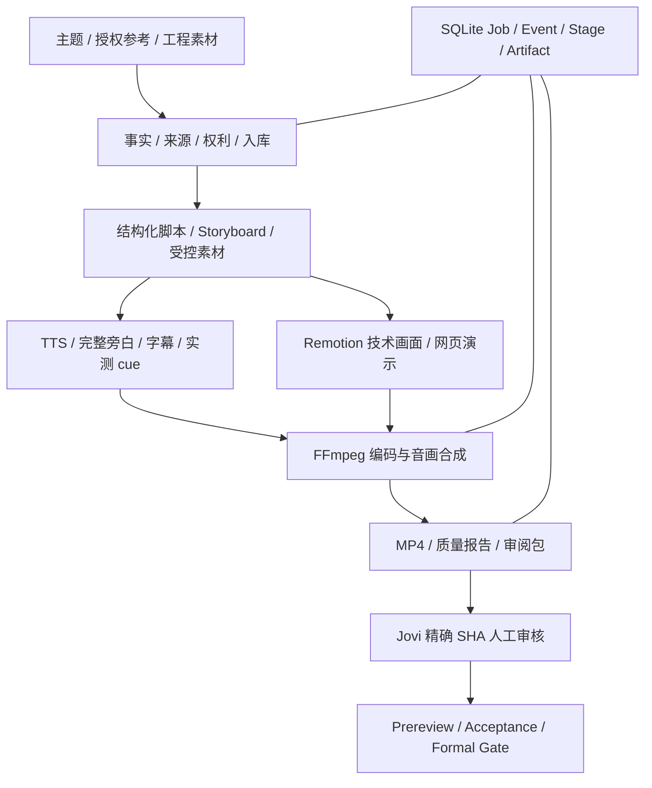

# 当前技术架构

Updated: 2026-10-24 · Phase 1 in_progress

## 主链

| 层 | 当前实现 | 职责 |
|---|---|---|
| 入口 | scripts/factory.py、src/factory/phase1_cli.py | 创建/执行/状态/取消/重试 |
| 控制平面 | src/factory/db.py、state.py | SQLite、幂等、生命周期、产物身份 |
| 主题规划 | phase1_local.py、director/ | 来源约束、结构化规划、Registry 选择 |
| 参考模式 | reference_video.py | 只读入库、digest、ffprobe、场景/节奏、可选 cached ASR、原创差异 |
| 音频 | phase1_subject_audio.py、pipeline/narration_timing.py、音频脚本 | TTS、source-aligned 旁白、完整性与片段时间 |
| 视觉 | remotion/、素材/Schema | 技术图、字幕安全区、WebsiteProductDemo、语音焦点 |
| 合成 | generate_video.py、video_factory/pipeline/renderer.py | FFmpeg、转场/精确时长、render report |
| 资格 | phase1_post_render_check.py、phase1_acceptance.py、phase1_gate.py | 质量、hash、单 Job 与整阶段 Gate |

## 音画与内容合同

先建立 source/aligned PCM/台词完整性，再绑定 Storyboard 与实测片段。有效语音不能通过裁尾、丢句或缩短输出满足目标时长；超出合同须显式失败或按授权重规划。

technical_cut 按约定帧数拼接，与原有转场路径并存。技术图焦点、字幕和动作绑定实际语音 cue。最终时长、声轨、完整 decode 和 review 媒体身份同时验证。

保留音频的只读审计也核对各文件的声明身份，并从实际解码 PCM 样本数计算时长；声明一致不能代替测量。原始、对齐和压缩后音频有不同的合法哈希，各自绑定正确角色和转换关系，不要求跨角色哈希相等。

协议、代码、公式、原理图优先 SVG/HTML/Remotion 确定性图形。App/网页使用授权真实截图/录屏；现有 WebsiteProductDemo 仅服务受控产品模板。website_product_demo_v1 的深色边缘例外不能放宽其他技术视频。图上标签正确不等于工程关系正确，仍须技术语义审核。

## 组件与采用边界

| 组件 | 实际采用 | 边界 |
|---|---|---|
| Remotion + FFmpeg/ffprobe | 现有主视觉/媒体引擎 | Phase 1 保留 |
| OpenMontage | 已选取适配的 AGPL-3.0-only 源码 | 见 third_party/openmontage/PROVENANCE.json、LICENSE、THIRD_PARTY_NOTICES；不能记成仅方法参考 |
| MoneyPrinterTurbo | 已有规划/文案草稿 adapter | 不接管状态/最终渲染；最近 I2C 受凭证阻塞 |
| PySceneDetect / faster-whisper | 参考分析 / 可选缓存 ASR | 缺失标注，不自动下载模型 |
| 剪映 | 可选编辑交付 | 不作为本地 MP4 合格的硬前置 |
| DaVinci MCP | 可选编辑器试验 | 最近记录只准备 MCP 环境；本机连接、剪辑、导出未证明 |
| ComfyUI / WhisperX | 后续增强 | 批准 workflow、模型预算、GPU 单并发 |

## 状态与未来入口

受管 CLI 的幂等键与不可变输入地址绑定完整规范化请求，包括画布和事实；显式键与不同请求冲突时拒绝。实际渲染目录由可信 SQLite Job/attempt 派生，重试使用新 lineage，旧候选保持。底层独立渲染 API 的既有稳定规划 ID 保持兼容；生产任务通过受管 CLI 获得上述隔离。

每个 Job/attempt 使用 SQLite 执行 claim；取消并明确重试后，旧所有者的数据库写入被 token/attempt fencing 拒绝。锁不按超时自动抢占；中断后使用明确的 cancel/retry 恢复。必须的产物先检查路径、文件和哈希，再与 PENDING_REVIEW 状态在一个事务内发布；待审任务重用前重新核对实际产物，失配转 FAILED，要求明确重试。

后渲染检查将实际媒体 SHA 与报告及存在的派生记录绑定，并核对 composition/content_kind/layout 的一致性。仅合法产品模板保留深色边缘例外；旧 RC/Flash 生产者状态按显式兼容表接受，仍须提供真实媒体身份。

本地 CLI 调用生产链，SQLite 保存持久状态。常规状态包括 NEW、RESEARCHING、SCRIPTING、VOICE、CAPTIONS、ASSETS、RENDERING、QUALITY_CHECK、PENDING_REVIEW；异常保留 FAILED/CANCELLED。READY 必须解析预期产物、strict Schema、跨文件身份和真实质量字段，不能只看退出码。

Phase 2 用 OpenClaw 承担飞书入口、调度、恢复与通知，调用既有本地链。后续网页/App 只增加任务创建、素材管理、预览和审核界面；接口/平台待相应阶段确定，不预先引入另一套数据库或视频编排。

## 当前缺口

Phase 1 尚未正式通过。历史 Flash/FreeRTOS 截断候选保持失败；I2C 最近凭证阻塞；各主题最终媒体人审、统一 Prereview、Lifecycle 绑定和 Manifest/Boundary/Gate 尚需闭合。详见 [审核说明](PROJECT_REVIEW.md)与[当前交接](../handoff/codex/CURRENT_HANDOFF.md)。
